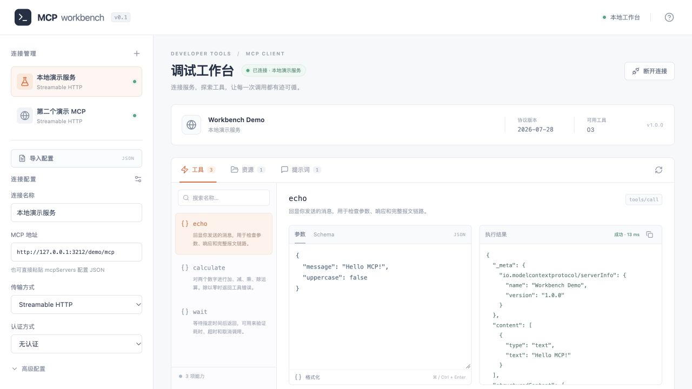
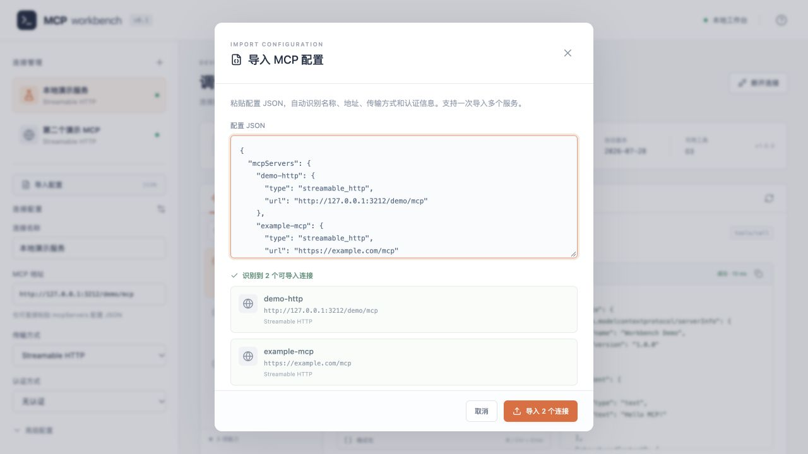
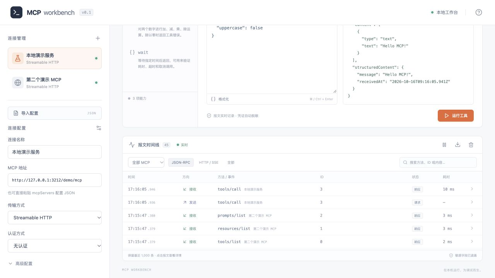
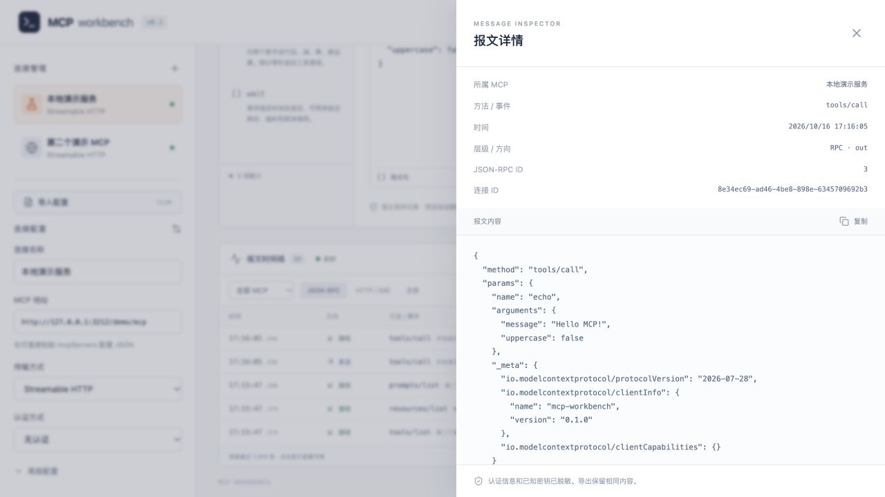

# MCP Workbench 使用手册

MCP Workbench 是一个在本机运行的 MCP 调试客户端。启动后，在浏览器中配置服务地址和认证信息，查看服务提供的工具、资源和提示词，并检查每次交互的 JSON-RPC 报文与 HTTP/SSE 传输内容。



左侧管理多个连接，右侧显示当前 MCP 的能力、调用参数和执行结果。连接旁的绿点表示在线，标题标明当前调试的 MCP。

> 本文截图均使用本地演示数据。截图环境使用 3212 端口，默认启动端口仍为 3210；两个演示连接用于展示多 MCP 同时在线。

## 1. 安装与启动

需要 Node.js 22.12 或更新版本及 npm。首次安装依赖需要联网；内置演示服务在本机运行。

在项目目录执行：

```bash
git clone git@github.com:messyLiu/mcp-client.git
cd mcp-client
npm ci
npm run build
npm start
```

`npm start` 会启动本地服务，并尝试自动打开默认浏览器。如果浏览器未打开，手动访问：

- 工作台：[http://127.0.0.1:3210](http://127.0.0.1:3210)
- 内置演示 MCP 端点：`http://127.0.0.1:3210/demo/mcp`

终端需要保持运行；按 `Ctrl+C` 停止服务。日常使用只需运行 `npm start`。修改前端代码后需要重新执行 `npm run build`。

开发模式：

```bash
npm run dev
```

开发模式同时运行后端和 Vite。打开终端显示的 Vite 地址（通常为 `http://127.0.0.1:5173`）；后端仍使用 3210 端口。页面修改会自动更新。

生产启动需要改端口时，在 macOS/Linux 使用：

```bash
PORT=3211 npm start
```

此时工作台地址变为 `http://127.0.0.1:3211`，演示配置中的 MCP 地址也要手动改为 `http://127.0.0.1:3211/demo/mcp`。开发模式的 Vite 代理默认指向 3210；如需修改开发后端端口，同时调整 `vite.config.ts`。

## 2. 用内置演示完成第一次调用

1. 在左侧点击 **本地演示服务**，工作台会自动连接并切换。
2. 保持传输方式为 **Streamable HTTP**、认证方式为 **无认证**。
3. 如果修改了配置，点击 **连接服务** 或 **保存并重新连接**。成功后页面显示 `Workbench Demo`、协议版本和可用工具数量。
4. 在 **工具** 标签页选择 `echo`。
5. 将参数改为以下 JSON，并点击 **运行工具**：

```json
{
  "message": "Hello MCP!",
  "uppercase": false
}
```

右侧应返回 `Hello MCP!`，底部报文时间线会出现 `tools/call` 的请求与响应。点击任意一条报文查看详情。

演示服务还提供：

| 能力 | 用途 | 示例参数 |
| --- | --- | --- |
| 工具 `echo` | 回显消息，可转换为大写 | `{"message":"hello","uppercase":true}` |
| 工具 `calculate` | 加减乘除；除以零返回工具错误 | `{"operation":"add","a":12,"b":30}` |
| 工具 `wait` | 测试耗时、超时和取消，范围 0–120 秒 | `{"seconds":2}` |
| 资源 `welcome` | 读取演示文本 | URI 为 `demo://welcome`，无需参数 |
| 提示词 `summarize` | 获取摘要提示词 | `{"text":"需要总结的内容"}` |

`calculate.operation` 支持 `add`、`subtract`、`multiply`、`divide`。要验证工具错误，可传入 `{"operation":"divide","a":1,"b":0}`。

## 3. 配置自己的 MCP 服务

### 自动识别并导入 JSON 配置

点击左侧 **导入配置**，粘贴服务提供方给出的 JSON。页面会自动识别并显示预览，点击 **导入 N 个连接** 保存。也可以将整段 JSON 直接粘贴到 **MCP 地址** 输入框，工作台会自动打开导入窗口。



预览会列出可导入的连接，确认名称、地址和传输方式后再导入。图中的 `example.com` 仅为配置示例。

例如，下面的配置会识别成名称为 `12306-mcp`、使用 Streamable HTTP、无认证的连接：

```json
{
  "mcpServers": {
    "12306-mcp": {
      "type": "streamable_http",
      "url": "https://example.com/mcp"
    }
  }
}
```

识别规则：

- 支持 `mcpServers` 中的多个服务，也支持含 `url` 的单个服务对象。
- `streamable_http`、`streamable-http`、`streamablehttp`、`http` 映射为 Streamable HTTP；`sse` 映射为旧式 HTTP+SSE。省略类型且提供 URL 时默认使用 Streamable HTTP。
- `headers.Authorization: "Bearer ..."` 自动识别为 Bearer Token；`X-API-Key`、`API-Key`、`apikey` 自动识别为 API Key 请求头（名称不区分大小写）。其他请求头放入高级配置。
- 也支持直接提供 `apiKey`；默认采用 Bearer Token，附带 `authHeader` 时采用自定义请求头认证。
- `timeoutMs` 以毫秒为单位；未提供时默认 30,000 毫秒。
- 同名连接自动追加 `(2)`、`(3)` 等后缀，已有配置不会被覆盖。
- 不支持的 `stdio`、无效地址和 `disabled: true` 服务会列出原因并跳过；只有预览中可导入的连接会被保存。额外未支持的字段会显示提示。不会执行 `command` 或展开 `${ENV_VAR}` 环境变量占位符。

识别和导入只操作本地配置。导入后选中首个连接，再点击 **连接服务** 才会访问该 MCP 地址。导入的密钥和请求头值仍然仅保留在服务进程内存中。

### 手动填写连接

点击左侧 **连接管理** 旁的加号，新建一个配置。

| 配置项 | 说明 |
| --- | --- |
| 连接名称 | 自定义名称，例如“开发环境”“测试服务” |
| MCP 地址 | 服务提供方给出的完整 HTTP/HTTPS 端点，例如 `https://example.com/mcp` |
| 传输方式 | 新服务优先选择 Streamable HTTP；只有服务明确使用旧式 HTTP+SSE 时才选择旧版 SSE |
| 认证方式 | 无认证、Bearer Token、API Key 自定义请求头 |
| API Key 请求头名称 | 仅自定义请求头认证使用，例如 `X-API-Key` |
| API Key | 填入凭证本身；Bearer 模式自动添加 `Bearer ` 前缀 |

点击 **保存配置** 只保存配置，不连接服务。点击 **连接服务** 会先保存，再建立连接并读取能力列表。已经连接同一配置时，按钮显示 **保存并重新连接**；修改配置后点击它才会应用到实际连接。

支持同时连接多个 MCP。点击左侧已保存的连接，会切换右侧工作台；目标尚未连接时自动连接，已经连接时直接复用现有会话。连接列表中的绿点表示在线，转圈表示正在连接，红点表示连接失败。页面标题显示当前 MCP 名称。

每个 MCP 的工具、资源、提示词、编辑参数、调用结果和进行中的调用分别管理。切换工作台不会终止其他 MCP 的连接或调用；点击 **断开连接** 只断开当前 MCP。参数与调用结果在当前浏览器页面中保留，刷新页面会重置；连接与报文由后端维护。多个浏览器标签页共享这些后端连接，任一页面断开同一个 MCP 都会同步生效。

切换列表使用已保存的配置；如需保留正在编辑的修改，请先点击 **保存配置**。新建或导入配置后，点击 **连接服务** 即可开始使用。

### 认证示例

如果服务要求：

```http
Authorization: Bearer your-token
```

选择 **Bearer Token**，API Key 中只填 `your-token`。

如果服务要求：

```http
X-API-Key: your-key
```

选择 **API Key · 自定义请求头**，请求头名称填 `X-API-Key`，API Key 填 `your-key`。

MCP 地址本身不能包含用户名和密码。服务要求 OAuth 登录时，本版本尚不提供完整的 OAuth 授权流程；若服务允许手动使用已取得的访问令牌，可通过 Bearer Token 配置。

### 高级配置

展开 **高级配置** 可以设置：

- **请求超时：** 1–300 秒，默认 30 秒，应用于连接、能力读取和调用。
- **协议协商：** 默认自动识别；可强制旧版 `initialize` 或 `2026-07-28`。新版模式不会回退到旧协议。
- **自定义请求头：** JSON 对象，所有值必须为字符串，例如：

```json
{
  "X-Tenant-ID": "sandbox",
  "X-Environment": "development"
}
```

传输层管理的请求头（如 `Host`、`Content-Length`、`Content-Type`、`Accept`、`Mcp-*`）不能通过此字段覆盖。认证方式填写的凭证优先于同名自定义请求头。

## 4. 调用工具、读取资源和获取提示词

### 工具

1. 连接后，在 **工具** 标签页选择工具，或按名称、描述搜索。
2. 在 **Schema** 标签查看服务公布的参数类型、必填项和说明。
3. 在 **参数** 标签编辑 JSON。自动生成的初始参数只是编辑起点；复杂 Schema 或业务必填值需要自行填写。
4. 点击 **格式化** 检查 JSON 语法并整理缩进。
5. 点击 **运行工具**，或在参数编辑器中按 `⌘+Enter`（macOS）/ `Ctrl+Enter`。
6. 右侧显示完整返回 JSON 和耗时。可点击复制图标复制结果。

参数必须是 JSON 对象，不能是字符串或数组。运行期间可点击 **取消调用**。取消会停止客户端等待并向支持的传输层发送取消信号，但不能撤销服务端已经完成的操作。

页面区分两种失败：网络、认证、协议等失败直接显示错误；工具返回 `isError: true` 时，保留完整结果并标记为 **工具报错**。

### 资源与提示词

- 在 **资源** 标签选择资源，点击 **读取资源**，查看返回的内容。
- 在 **提示词** 标签选择模板，填写参数后点击 **获取提示词**。提示词参数值必须是字符串。工作台展示返回的消息，不会自动发送给语言模型。
- 服务没有声明某类能力时，对应列表为空。点击能力区右上角刷新图标可重新读取列表。

## 5. 查看、筛选和导出报文

底部 **报文时间线** 在连接开始时就记录交互，包括版本探测、握手、能力列表、业务调用、通知和错误。



上图选择了 **全部 MCP** 和 **JSON-RPC**，可看到 echo 调用的请求、响应以及另一服务的能力发现报文。切回 **当前 MCP** 可只查看当前配置的记录。

| 筛选标签 | 内容 |
| --- | --- |
| JSON-RPC | SDK 传输边界观察到的结构化请求、响应、通知和协议错误 |
| HTTP / SSE | 请求地址、方法、请求头、请求体、响应状态与响应头，以及响应体或 SSE 帧 |
| 全部 | 上述两层和系统错误 |

这两层是同一次交互的不同视角，因此 **全部** 中的一次调用通常对应多条记录。它们是应用层记录，不是 TCP/TLS 抓包。

报文默认显示 **当前 MCP** 的记录（包含本次运行中该配置重连前后的历史），可通过连接范围选择器切换为 **全部 MCP**。切换连接或重新连接不会隐藏该 MCP 的历史报文；断开后也可以查看。报文详情显示所属 MCP 和连接 ID，全部 MCP 视图同时显示来源名称。后端重启会清空内存中的报文。每条记录显示时间、方向、方法/事件、JSON-RPC ID、状态和耗时。请求与响应按连接 ID 和 JSON-RPC ID 一起配对；不同服务可能使用相同的 JSON-RPC ID。详情中的 **HTTP 交换 ID** 将同一次 HTTP 请求、响应头和响应内容关联起来。JSON-RPC 响应耗时从发送对应请求计算；HTTP 响应头耗时从发起 HTTP 请求计算。

- **搜索：** 按方法、ID、事件类型或记录内容搜索。
- **查看详情：** 点击一行，右侧展开报文内容；支持复制。
- **暂停显示：** 冻结当前时间线，后端仍继续采集。再次点击恢复最新记录。
- **导出：** 点击下载图标，导出当前后端保留的全部记录为 `mcp-trace.json`；不受页面筛选或暂停状态影响。
- **清空：** 点击垃圾桶图标，清除全部 MCP 的记录（不受当前筛选范围影响）；不影响连接，后续报文继续采集。



点击时间线中的记录打开详情。上图为 `echo` 的发送请求，可以核对所属 MCP、请求参数和 JSON-RPC ID，并复制报文内容。

后端最多保留最近 **1,000 条**记录，刷新页面后可恢复尚未淘汰的记录。停止服务会清空记录。单条较大的内容以约 **64 KiB** 为上限截断，并在详情中标识；被截断或已淘汰的内容不能通过导出恢复。需要留档时请及时导出。

## 6. 配置和凭证保存在哪里

- 非敏感连接配置保存在项目的 `.data/profiles.json`，包括名称、地址、认证类型、超时和请求头名称。
- **API Key 和自定义请求头的值只保存在服务进程内存中。** 刷新浏览器不会清除，重启后端会清除，需要重新填写。
- 已保存的 API Key 不会回传到浏览器。输入框显示“本次运行已保存，留空沿用”时，空输入会继续使用原凭证；点击“清除已保存的密钥”，再保存即可移除。
- API Key、已配置的请求头值，以及名称含 `authorization`、`cookie`、`password`、`secret`、`token`、`apiKey` 等的常见敏感字段，会在报文记录中遮盖为 `[REDACTED]`。复制和导出使用同样的脱敏内容。
- 脱敏并不识别所有业务隐私，例如工具返回的姓名或订单信息。分享导出文件前，请检查其中的业务内容。
- 请把凭证填在认证或请求头配置中。URL 属于持久化配置，避免将密钥放入查询参数。

工作台只监听 `127.0.0.1`，供本机浏览器使用。对远程 MCP 的请求由本地后端发出，因此远程服务不需要为工作台页面另设浏览器 CORS。

## 7. 常见问题

| 现象 | 处理方式 |
| --- | --- |
| 页面打不开 | 确认 `npm start` 仍在运行，检查终端地址和端口 |
| 提示先运行 build | 执行 `npm run build`，然后重启服务 |
| `EADDRINUSE` | 3210 端口已被占用；停止原服务或使用其他端口 |
| 无法连接本地服务 | 确认后端运行；开发模式检查 Vite 代理是否指向正确端口 |
| 页面会话已过期 | 后端重启后令牌变化，刷新浏览器再操作 |
| HTTP 401 / 403 | 检查凭证有效期、认证方式、API Key 请求头名称和服务权限 |
| HTTP 404 / 405 | 检查完整 MCP 端点和传输类型；不要填服务首页地址 |
| 请求超时 | 检查服务是否可达，或在高级配置中增大超时；取消或超时不会撤销已完成的业务操作 |
| 请求被重定向而失败 | 工作台默认拒绝 HTTP 重定向，请直接填写最终 MCP 端点 |
| TLS / 证书错误 | 修复目标服务证书或本机信任配置；工作台不提供跳过证书校验开关 |
| 工具列表为空 | 服务可能不支持 Tools；检查资源/提示词，或点击刷新能力列表 |
| API Key 重启后消失 | 这是预期行为；凭证不写入配置文件 |
| 参数校验失败 | 查看 Schema 的必填项、类型和枚举；JSON 字符串需要双引号 |
| 时间线显示“正在重连” | 页面与本地服务的事件流中断，会自动重连；持续异常时检查后端并刷新页面 |

## 8. 当前支持范围

已实现：多个连接配置、多个独立 MCP 会话同时在线、点击列表切换工作台、按连接保存参数及调用结果、Streamable HTTP、旧式 HTTP+SSE、Bearer/API Key、额外请求头、协议协商、工具调用、静态资源读取、提示词获取、超时与取消、双层报文记录、按连接筛选、搜索与导出。

当前未实现：启动本地 `stdio` 子进程、完整 OAuth 登录、资源模板展开、订阅管理、语言模型 Sampling、交互式 Elicitation/MRTR 表单、任务扩展、跨重启报文历史、密钥库持久化和多用户共享部署。仅声明已经实现的客户端能力；相关高级功能需要后续扩展。

## 9. 开发和验证

```bash
npm run build   # TypeScript 类型检查与前端构建
npm test        # 本地集成测试及报文记录测试
```

项目结构：

```text
mcp-client/
├── src/                 浏览器界面与样式
├── server/              本地 API、MCP 连接管理、报文记录、配置存储、演示服务
├── shared/              前后端共用类型
├── tests/               本地自动化测试
├── docs/
│   └── screenshots/     README 和使用手册中的正式截图
├── .artifacts/          本地调试产物，不提交 Git
│   └── screenshots/     临时验证截图
├── .data/               本机配置，不提交 Git
├── dist/                前端构建产物，不提交 Git
├── README.md            项目介绍与使用手册
├── package.json         依赖和运行脚本
├── package-lock.json    依赖版本锁定
├── index.html           前端页面入口
├── tsconfig.json        TypeScript 配置
└── vite.config.ts       Vite 配置
```

图片存放约定：正式文档截图统一放在 `docs/screenshots/`，README 使用相对路径引用，以便 GitHub 直接显示；临时调试截图放在 `.artifacts/screenshots/`，整个 `.artifacts/` 目录已忽略。截图使用演示数据，文件名描述用途，扩展名与实际格式一致。

浏览器到本地服务使用普通 HTTP API 和事件流；本地服务使用官方 MCP TypeScript SDK 与目标 MCP 交互。前端通过 React 渲染，生产模式由同一个 Node.js 服务提供页面和 API。
